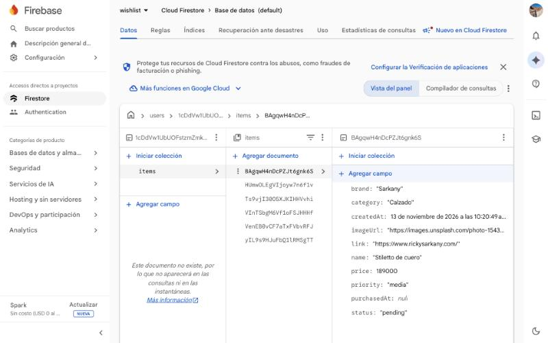

# Bitácora — WISHLIST

Registro del proceso de desarrollo, las versiones publicadas y el uso de herramientas de IA.

- **App publicada:** https://wishlist-two-khaki.vercel.app
- **Repositorio:** https://github.com/Martina2003-cod/wishlist
- **Versiones (tags de Git):** [`v1.0`](https://github.com/Martina2003-cod/wishlist/tree/v1.0) · [`v2.0`](https://github.com/Martina2003-cod/wishlist/tree/v2.0) · [`v3.0`](https://github.com/Martina2003-cod/wishlist/tree/v3.0)

---

## Idea inicial

**Necesidad:** las prendas que queremos comprar quedan dispersas en capturas, links, redes y carritos de distintas tiendas. Eso dificulta comparar precios y hace que nos olvidemos de productos.

**Solución:** WISHLIST es un archivo personal de deseos. No vende nada: permite guardar prendas de cualquier marca, ordenarlas por prioridad, marcarlas como compradas y ver el presupuesto pendiente.

**Público:** jóvenes de 18 a 35 años interesados en moda, que descubren productos en Instagram, Pinterest, TikTok o tiendas online.

**Información guardada:** nombre, marca, precio, categoría, URL de la imagen, enlace a la tienda, prioridad, estado (pendiente o comprado) y fechas de creación y compra.

**Alcance:** se dejaron afuera, a propósito, los pagos, el seguimiento automático de precios y las integraciones con tiendas. La carga es manual, con una URL de imagen, para concentrarse en el CRUD con Firebase y en la experiencia de uso.

---

## Decisiones de diseño

La interfaz no se pensó como una tienda, sino como una **revista de moda**. Las referencias fueron el diseño editorial de *Vogue*, la sobriedad de *The Row* y los sitios de moda de lujo. Partí de mi propuesta (paleta, tipografías y estructura de la Home) y fui refinando el resultado en varias iteraciones.

| Decisión | Por qué |
| --- | --- |
| **Paleta neutra:** off-white `#F6F3ED`, negro carbón `#171717`, beige arena `#C8BBA9` | El protagonismo es de las fotos de las prendas. El fondo cálido evita el blanco puro, que se ve "de sistema". |
| **Rojo editorial `#A43E36` sólo para acciones y acentos** | Si el rojo aparece poco, guía la mirada: botones principales, el estado *Comprado*, la prioridad alta y las palabras destacadas en los títulos. |
| **Cormorant Garamond** en los títulos e **Inter** en textos y botones | La serif con itálicas da el tono de revista. La sans garantiza la legibilidad en formularios y en el celular. |
| **Secciones numeradas** (02 Editor's Letter, 03 Your Edit, 04 The Archive, 05 Colophon) y **prendas numeradas** (N° 01, N° 02…) | Imitan la diagramación de una revista y ordenan el recorrido de arriba hacia abajo. |
| **Mucho espacio en blanco, divisores finos y títulos grandes** | Transmiten calma y lujo, en vez de la saturación de un ecommerce. |
| **Fotos en formato 3:4** | Es el formato de las fotos de moda: la prenda se ve completa. |
| **Agregar y Detalle como paneles sobre la Home** | El usuario no pierde el contexto de su colección. *Categorías* y *Purchased* se resolvieron como filtros y pestañas, como sugería la propuesta. |
| **Acciones rápidas al pasar el mouse** (Ver, Editar, ✓ Comprado) | Mantienen las tarjetas limpias y dejan las acciones a mano. En el celular, como no hay mouse, las acciones están en el detalle. |

**Iteraciones sobre la interfaz:**
1. **Primera versión:** la estructura en cinco secciones con la paleta y las tipografías de la propuesta.
2. **Ajustes después de probarla:**
   - Las acciones rápidas, que al principio se superponían mal, pasaron a ubicarse sobre la foto.
   - Se corrigió un scroll horizontal en el celular, causado por la fila de categorías.
   - Se cambiaron los nombres de prendas de ejemplo que no coincidían con sus fotos.
   - Se evitó que el modal robara el foco mientras se escribía.
3. **v2:** se agregó un estado vacío con dos caminos (agregar la primera prenda o cargar ejemplos) y el total invertido en el resumen.
4. **v3:** se mejoró la accesibilidad (el foco queda dentro de los modales) y el rendimiento de la carga.

---

## Versión 1 — Aplicación funcional · `v1.0`

**Fecha:** 13 de noviembre de 2026 · **Commit:** `43112f3` (+ `80f8109`, link en README)

**Objetivo:** tener la aplicación completa conectada a Firebase con las cuatro operaciones CRUD y la identidad visual definida en la propuesta.

**Cambios:**
- Proyecto **React + Vite**.
- **Firebase:** login anónimo (`src/firebase.js`) y Cloud Firestore en `users/{uid}/items/{itemId}` (`src/services/wishlistService.js`), con actualización en tiempo real (`onSnapshot`).
- **CRUD:** agregar, ver, editar, eliminar (con confirmación) y marcar como comprado / pendiente.
- **Validaciones** del formulario: nombre, marca, precio mayor a 0, categoría y URLs válidas, más vista previa en vivo de la tarjeta.
- **Filtros:** pestañas Todo / My Wishlist / Purchased, categorías, prioridad, búsqueda por texto y orden.
- **Resumen de presupuesto:** guardados, pendientes, comprados y total pendiente en ARS.
- **Feedback:** estados de carga (skeletons y spinners), mensajes de éxito/error (toasts) y estados vacíos.
- **Diseño** Luxury Editorial: Cormorant Garamond + Inter, paleta off-white / carbón / arena / rojo editorial, diseño responsive.
- **Seguridad:** reglas de Firestore por usuario y con validación de campos (`firestore.rules`).
- **Deploy** en Vercel con las variables de entorno de Firebase.

**Capturas:**

| Home | Resumen (sin datos) | Validaciones |
| --- | --- | --- |
|  |  |  |

---

## Versión 2 — Mejoras de experiencia · `v2.0`

**Fecha:** 13 de noviembre de 2026 · **Commit:** `ba208e0`

**Problema detectado:** con el login anónimo, cada navegador es un usuario nuevo. Quien abre la app por primera vez (por ejemplo, el profesor) la ve vacía y no puede apreciar la grilla ni los filtros sin cargar varias prendas a mano.

**Cambios:**
- **Botón "Cargar prendas de ejemplo"** en el estado vacío: guarda 6 prendas en Firestore en una sola operación (`writeBatch`).
- **Total invertido:** la tarjeta *Comprados* del resumen muestra el dinero gastado en prendas compradas, además del porcentaje cumplido.

**Capturas:**

| Resumen con total invertido | Colección con ejemplos | Detalle de producto |
| --- | --- | --- |
|  |  |  |

---

## Versión 3 — Diseño final · `v3.0`

**Fecha:** 13 de noviembre de 2026 · **Commit:** `787193e`

**Cambios:**
- **Rendimiento:** Firebase y React se separan en paquetes propios (`vite.config.js`). El código de la app pasó de **612 KB a 32 KB** y desapareció el aviso de Vite por paquetes grandes.
- **Accesibilidad:** el foco del teclado queda dentro de los modales (Tab y Shift+Tab), además de cerrar con `Escape`.
- **Metadatos Open Graph:** el link muestra título, descripción e imagen al compartirlo.
- **Datos de ejemplo:** se corrigió el nombre de una prenda para que coincida con su foto.

**Capturas:**

| Home final | Footer | Celular (375 px) |
| --- | --- | --- |
|  |  |  |

---

## Cómo se verificó cada actualización

Vercel está conectado al repositorio y publica solo cada vez que se sube un cambio a `main`. Para cada versión:

1. Se ejecutó `npm run build` localmente para comprobar que compilara sin errores.
2. Se hizo el commit, se subió a GitHub y se marcó la versión con un tag (`v1.0`, `v2.0`, `v3.0`).
3. Se esperó el nuevo despliegue y se confirmó que la URL pública sirviera el código nuevo, buscando en el HTML publicado un texto o archivo propio de esa versión:
   - **v2:** el botón "Cargar prendas de ejemplo".
   - **v3:** los archivos `firebase-*.js` y `react-*.js` y la etiqueta `og:title`.

   En ambos casos el despliegue tardó unos 15 segundos.
4. Se probó la versión publicada desde la URL de Vercel:
   - **v2:** cargar ejemplos y ver el total invertido.
   - **v3:** comprobar los paquetes separados, que el foco no saliera del modal y que la vista de celular no tuviera scroll horizontal.
5. Se revisó que la consola del navegador no mostrara errores.

---

## Dificultades y soluciones

| Dificultad | Cómo se investigó | Solución |
| --- | --- | --- |
| La computadora **no tenía Node.js**, así que no se podía ejecutar `npm` | Al intentar correr el proyecto, la terminal respondía `command not found: node` | Se instaló Node.js 22 LTS desde nodejs.org en la carpeta del usuario (sin permisos de administrador), verificando la descarga con su firma SHA-256 |
| **Scroll horizontal en el celular** | Se midió el ancho de la página a 375 px y se buscaron los elementos que se salían del borde: la fila de categorías se estiraba al ancho de su contenido | Se limitó el ancho de los filtros y la fila de categorías pasó a desplazarse por dentro, con scroll horizontal propio |
| **Fotos de ejemplo que no coincidían con el nombre** (unos "aros" eran un collar de perlas; una cartera "camel" era roja) | Revisando las capturas del detalle de cada prenda | Se renombraron las prendas de ejemplo |
| En Firebase, **el selector de ubicación de Firestore no se abría** en una ventana angosta | Al probar con una ventana más ancha, la lista apareció | Se eligió São Paulo (`southamerica-east1`) desde la vista ancha |
| **No se podía autorizar GitHub CLI:** el botón "Authorize" quedaba deshabilitado y un código de acceso se venció | En la configuración de GitHub (*Authorized OAuth Apps*) se comprobó que la autorización no se había registrado | Se generó un código nuevo y se autorizó desde Chrome, donde el botón sí se habilitaba |
| **Vercel no dejaba desplegar:** pedía instalar la integración con GitHub | El mensaje de error del formulario lo indicaba | Se instaló la app de Vercel en GitHub, sólo para el repositorio `wishlist` |
| **Vercel pidió verificar la identidad** con un código por email | — | Se ingresó el código recibido por email |
| **La app publicada arrancaba vacía:** con el login anónimo, cada navegador es un usuario nuevo | Se comparó la app en `localhost` (con datos) y en Vercel (vacía): eran usuarios distintos | **v2:** se agregó el botón "Cargar prendas de ejemplo" |
| **Aviso de Vite por un archivo de más de 500 KB** | El build mostraba el aviso; el peso venía casi todo de la librería de Firebase | **v3:** se separaron Firebase y React en archivos propios. El código de la app quedó en 32 KB |
| El dominio de Vercel tenía que estar **autorizado en Firebase** | La documentación del README y la consigna lo indicaban | Se agregó `wishlist-two-khaki.vercel.app` en *Authentication → Configuración → Dominios autorizados* |

---

## Pruebas realizadas

Las pruebas se hicieron en el navegador sobre la app local y sobre la publicada en Vercel.

| Prueba | Resultado esperado | Resultado |
| --- | --- | --- |
| Guardar el formulario vacío | Error en cada campo obligatorio | ✅ |
| Precio vacío | "Ingresá un precio mayor a 0." | ✅ |
| URL de imagen inválida | "Pegá una URL válida (https://…)." | ✅ |
| Agregar prenda | Aparece en la grilla con un toast de éxito | ✅ (local y Vercel) |
| Recargar la página | La prenda sigue ahí (persistencia en Firestore) | ✅ (local y Vercel) |
| Editar una prenda | Se actualizan la tarjeta y el resumen | ✅ |
| Marcar como comprado y volver a pendiente | Cambia de pestaña y de contador; las reglas aceptan la actualización | ✅ |
| Eliminar | Pide confirmación y desaparece | ✅ (Vercel) |
| Filtrar por categoría y limpiar filtros | Muestra solo esa categoría y luego todas | ✅ |
| Cargar prendas de ejemplo (v2) | 6 prendas guardadas en Firestore | ✅ (Vercel) |
| Otro origen o navegador | Wishlist vacía: los datos están separados por usuario | ✅ (localhost y Vercel muestran datos distintos) |
| Celular (375 px) | 2 columnas, sin scroll horizontal | ✅ |
| Foco en los modales (v3) | Tab no sale del modal | ✅ |
| Consola del navegador | Sin errores | ✅ |
| Registro visible en **Firestore → Datos** | El documento aparece en `users/{uid}/items` con todos sus campos | ✅ |

**Evidencia en Firebase Console:** cada visitante anónimo es un documento dentro de `users`, y sus prendas están en la subcolección `items`.

---

## Uso de IA

**Herramienta:** Claude (Anthropic), a través de Claude Code (aplicación de escritorio).

**Cómo la usé:** la usé como herramienta de apoyo en distintas etapas del trabajo, siempre partiendo de mi propuesta (concepto, funcionalidades, estructura de la Home, paleta y tipografías):
- **Código:** me ayudó a llevar la propuesta a código con React + Vite (componentes, estilos y la conexión con Firebase y sus reglas).
- **Configuración:** me acompañó paso a paso para instalar Node.js, configurar Firebase, subir el repositorio a GitHub y publicar en Vercel.
- **Errores:** me ayudó a interpretar y resolver los problemas que fueron apareciendo, como los detallados en *Dificultades y soluciones*.
- **Iteraciones:** sobre la base funcional, definimos e implementamos las mejoras de las versiones 2 y 3.
- **Documentación:** me ayudó a organizar el README y esta bitácora.

**Mi parte del trabajo:**
- Definí el concepto, el nombre, el público objetivo y las funcionalidades.
- Definí la estética Luxury Editorial (paleta, tipografías y referencias) y la estructura de la Home.
- Tomé las decisiones de configuración: el repositorio público y los nombres del proyecto.
- Hice los pasos que dependían de mis cuentas: crear las cuentas, iniciar sesión, autorizar permisos y verificar mi identidad.
- Probé la aplicación publicada, también desde el celular, cargando mis propias prendas.

**Reflexión:**
La IA aceleró mucho la parte técnica: en una sola sesión pasé de la propuesta a una app publicada y conectada a una base de datos real. Igual tuve que entender qué estaba pasando para tomar decisiones: por qué los datos se separan por usuario anónimo, por qué el archivo `.env` no se sube a GitHub y por qué la app publicada empieza vacía. También aprendí que hay pasos que la IA no puede ni debe hacer por mí, como iniciar sesión o autorizar permisos en mis cuentas. Como límite, el código generado hay que revisarlo y probarlo: en las pruebas aparecieron detalles a corregir que no eran evidentes a simple vista.
