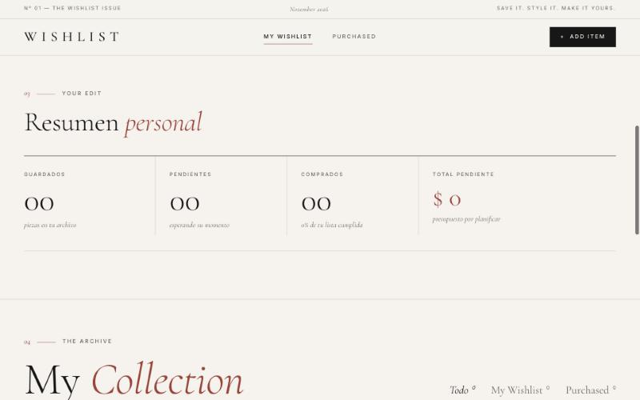
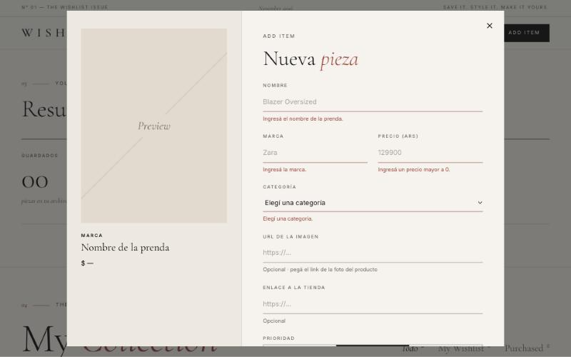
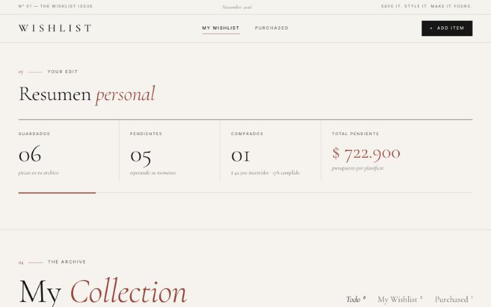
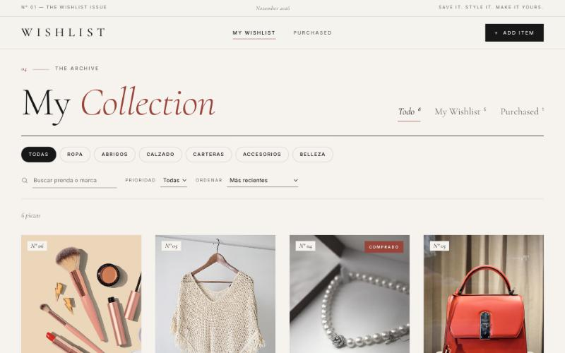
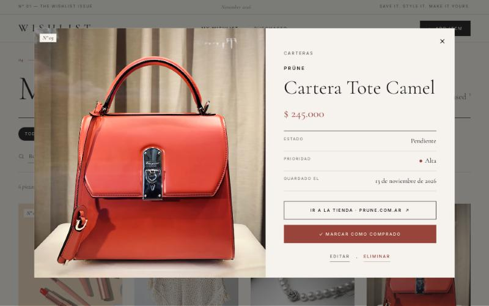
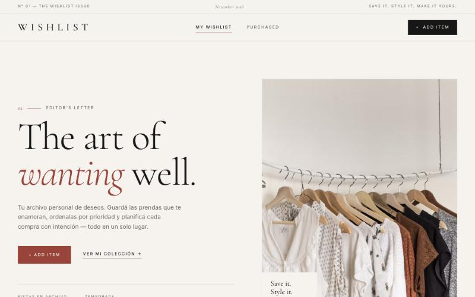
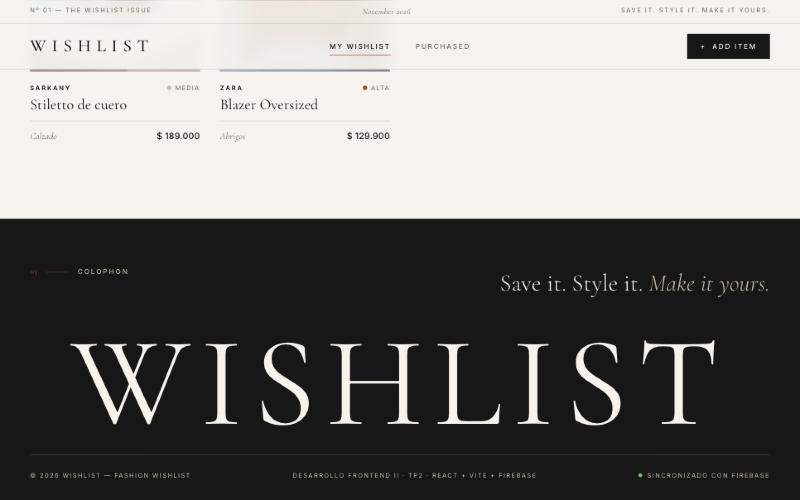
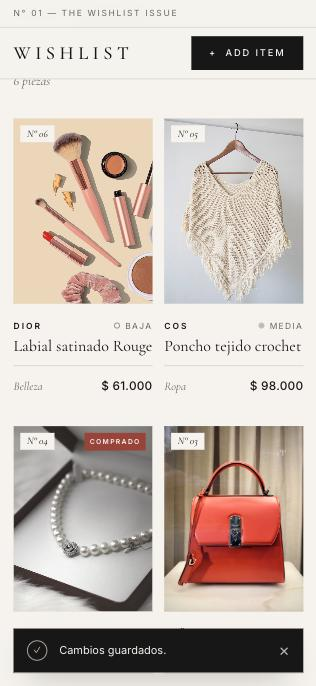

# Bitácora — WISHLIST

Registro del proceso de desarrollo, las versiones publicadas y el uso de herramientas de IA.

- **App publicada:** https://wishlist-two-khaki.vercel.app
- **Repositorio:** https://github.com/Martina2003-cod/wishlist
- **Versiones (tags de Git):** [`v1.0`](https://github.com/Martina2003-cod/wishlist/tree/v1.0) · [`v2.0`](https://github.com/Martina2003-cod/wishlist/tree/v2.0) · [`v3.0`](https://github.com/Martina2003-cod/wishlist/tree/v3.0)

---

## Punto de partida

La propuesta (TP2) definió la aplicación: una wishlist de moda con estética *Luxury Editorial*, CRUD completo sobre Firebase, autenticación anónima con reglas por usuario y una Home en cinco secciones (Header, Hero editorial, Resumen personal, My Collection y Footer).

---

## Versión 1 — Aplicación funcional · `v1.0`

**Fecha:** 13 de noviembre de 2026 · **Commit:** `43112f3` (+ `80f8109`, link en README)

**Objetivo:** tener la aplicación completa conectada a Firebase con las cuatro operaciones CRUD y la identidad visual definida en la propuesta.

**Cambios:**
- Proyecto **React + Vite**.
- **Firebase:** login anónimo (`src/firebase.js`) y Cloud Firestore en `users/{uid}/items/{itemId}` (`src/services/wishlistService.js`), con actualización en tiempo real (`onSnapshot`).
- **CRUD:** agregar, ver, editar, eliminar (con confirmación) y marcar como comprado / pendiente.
- **Validaciones** del formulario: nombre, marca, precio mayor a 0, categoría y URLs válidas, más vista previa en vivo de la tarjeta.
- **Filtros:** pestañas Todo / My Wishlist / Purchased, categorías, prioridad, búsqueda por texto y orden.
- **Resumen de presupuesto:** guardados, pendientes, comprados y total pendiente en ARS.
- **Feedback:** estados de carga (skeletons y spinners), mensajes de éxito/error (toasts) y estados vacíos.
- **Diseño** Luxury Editorial: Cormorant Garamond + Inter, paleta off-white / carbón / arena / rojo editorial, diseño responsive.
- **Seguridad:** reglas de Firestore por usuario y con validación de campos (`firestore.rules`).
- **Deploy** en Vercel con las variables de entorno de Firebase.

**Capturas:**

| Home | Resumen (sin datos) | Validaciones |
| --- | --- | --- |
|  |  |  |

---

## Versión 2 — Mejoras de experiencia · `v2.0`

**Fecha:** 13 de noviembre de 2026 · **Commit:** `ba208e0`

**Problema detectado:** con el login anónimo, cada navegador es un usuario nuevo. Quien abre la app por primera vez (por ejemplo, el profesor) la ve vacía y no puede apreciar la grilla ni los filtros sin cargar varias prendas a mano.

**Cambios:**
- **Botón "Cargar prendas de ejemplo"** en el estado vacío: guarda 6 prendas en Firestore en una sola operación (`writeBatch`).
- **Total invertido:** la tarjeta *Comprados* del resumen muestra el dinero gastado en prendas compradas, además del porcentaje cumplido.

**Capturas:**

| Resumen con total invertido | Colección con ejemplos | Detalle de producto |
| --- | --- | --- |
|  |  |  |

---

## Versión 3 — Diseño final · `v3.0`

**Fecha:** 13 de noviembre de 2026 · **Commit:** `787193e`

**Cambios:**
- **Rendimiento:** Firebase y React se separan en paquetes propios (`vite.config.js`). El código de la app pasó de **612 KB a 32 KB** y desapareció el aviso de Vite por paquetes grandes.
- **Accesibilidad:** el foco del teclado queda dentro de los modales (Tab y Shift+Tab), además de cerrar con `Escape`.
- **Metadatos Open Graph:** el link muestra título, descripción e imagen al compartirlo.
- **Datos de ejemplo:** se corrigió el nombre de una prenda para que coincida con su foto.

**Capturas:**

| Home final | Footer | Celular (375 px) |
| --- | --- | --- |
|  |  |  |

---

## Pruebas realizadas

Las pruebas se hicieron en el navegador sobre la app local y sobre la publicada en Vercel.

| Prueba | Resultado esperado | Resultado |
| --- | --- | --- |
| Guardar el formulario vacío | Error en cada campo obligatorio | ✅ |
| Precio vacío | "Ingresá un precio mayor a 0." | ✅ |
| URL de imagen inválida | "Pegá una URL válida (https://…)." | ✅ |
| Agregar prenda | Aparece en la grilla con un toast de éxito | ✅ (local y Vercel) |
| Recargar la página | La prenda sigue ahí (persistencia en Firestore) | ✅ (local y Vercel) |
| Editar una prenda | Se actualizan la tarjeta y el resumen | ✅ |
| Marcar como comprado y volver a pendiente | Cambia de pestaña y de contador; las reglas aceptan la actualización | ✅ |
| Eliminar | Pide confirmación y desaparece | ✅ (Vercel) |
| Filtrar por categoría y limpiar filtros | Muestra solo esa categoría y luego todas | ✅ |
| Cargar prendas de ejemplo (v2) | 6 prendas guardadas en Firestore | ✅ (Vercel) |
| Otro origen o navegador | Wishlist vacía: los datos están separados por usuario | ✅ (localhost y Vercel muestran datos distintos) |
| Celular (375 px) | 2 columnas, sin scroll horizontal | ✅ |
| Foco en los modales (v3) | Tab no sale del modal | ✅ |
| Consola del navegador | Sin errores | ✅ |

---

## Uso de IA

**Herramienta:** Claude (Anthropic), a través de Claude Code (aplicación de escritorio).

**Cómo la usé:** partí de mi propuesta escrita (concepto, funcionalidades, estructura de la Home, paleta y tipografías) y le pedí a la IA que la implementara. La IA:
- generó el proyecto React + Vite, los componentes y los estilos a partir de la propuesta;
- escribió la capa de datos con Firebase (Auth anónimo + Firestore) y las reglas de seguridad;
- probó la app en un navegador (alta, edición, borrado, filtros, vista mobile) y corrigió los errores que encontró, por ejemplo un scroll horizontal en celular y nombres de ejemplo que no coincidían con las fotos;
- me guió para crear el proyecto de Firebase, el repositorio de GitHub y el deploy en Vercel. Los pasos que requerían mi cuenta (iniciar sesión, aceptar términos, autorizar permisos, códigos de verificación) los hice yo;
- implementó las mejoras de las versiones 2 y 3 y redactó el README y esta bitácora.

**Pedidos principales a la IA:**
1. *"Hacé todo vos"* — a partir de la propuesta del TP2 y de la descripción de la Home en cinco secciones.
2. *"Instalame Node y corré la app."*
3. *"Ayudame a conectar Firebase."*
4. *"Subilo a GitHub y publicalo en Vercel."*
5. *"Hacé todos los pasos que faltan para que quede listo para entregar."*

**Decisiones tomadas por mí:** el concepto y nombre de la app, el público objetivo, las funcionalidades, la estética Luxury Editorial (paleta, tipografías, referencias) y la estructura de la Home; que el repositorio fuera público; los nombres del proyecto y del repositorio.

**Reflexión** *(borrador — revisar y completar con mis palabras)*:
La IA aceleró mucho la parte técnica: en una sola sesión pasé de la propuesta a una app publicada y conectada a una base de datos real. Igual tuve que entender qué estaba pasando para tomar decisiones: por qué los datos se separan por usuario anónimo, por qué el archivo `.env` no se sube a GitHub y por qué la app publicada empieza vacía. También aprendí que hay pasos que la IA no puede ni debe hacer por mí, como iniciar sesión o autorizar permisos en mis cuentas. Como límite, el código generado hay que revisarlo y probarlo: en las pruebas aparecieron detalles a corregir que no eran evidentes a simple vista.
