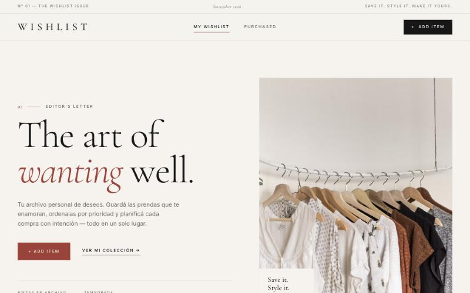

# WISHLIST — Fashion Wishlist

> **Save it. Style it. Make it yours.**
> Desarrollo Frontend II · TP2

**🔗 App publicada:** https://wishlist-two-khaki.vercel.app

> **Primera visita:** cada navegador es un usuario anónimo distinto, así que la app arranca vacía. Tocá **"Cargar prendas de ejemplo"** para ver la colección con 6 prendas, o agregá las tuyas con **+ Add Item**.



WISHLIST es una aplicación web para **guardar, organizar y gestionar las prendas y accesorios que queremos comprar**. No es un ecommerce: funciona como un archivo personal de deseos, con una estética *Luxury Editorial* inspirada en revistas de moda.

---

## Funcionalidades

| Funcionalidad | Descripción | CRUD |
| --- | --- | --- |
| Agregar producto | Nombre, marca, precio, categoría, imagen (URL), enlace y prioridad | **Create** |
| Ver productos | Grilla editorial en tiempo real | **Read** |
| Editar producto | Modificar cualquier dato de la prenda | **Update** |
| Marcar como comprado | Cambia el estado *pendiente ↔ comprado* | **Update** |
| Eliminar producto | Con confirmación previa | **Delete** |
| Filtrar y buscar | Por estado (pestañas), categoría, prioridad y texto; orden por fecha, prioridad o precio | — |
| Resumen de presupuesto | Guardados, pendientes, comprados (con total invertido) y total pendiente en ARS | — |
| Prendas de ejemplo | Carga 6 prendas en Firestore cuando la wishlist está vacía | **Create** |

Además: validaciones de formulario, estados de carga (skeletons y spinners), mensajes de éxito/error (toasts), estados vacíos, diseño responsive y accesibilidad (teclado, `aria-*`, foco visible y atrapado dentro de los modales, `Escape` cierra modales).

## Estructura de la Home

1. **Header / Navegación** — Logo · My Wishlist · Purchased · Add Item
2. **Hero editorial** — Título protagonista, bajada e imagen de moda
3. **Resumen personal** — Guardados · Pendientes · Comprados · Total
4. **My Collection** — Pestañas, filtros, grilla de productos y acciones
5. **Footer** — Identidad de marca y créditos

*Add Item* e *Item Detail* se presentan como paneles modales sobre la Home; *Categories* y *Purchased* se resuelven como filtros y pestañas dentro de la colección.

## Tecnologías

- **React 18 + Vite 5**
- **Firebase**: Authentication (anónimo) + Cloud Firestore
- CSS propio (sin frameworks) · Cormorant Garamond + Inter

## Estructura del proyecto

```
wishlist/
├── firestore.rules            # Reglas de seguridad por usuario
├── .env.example               # Variables de Firebase
├── index.html
└── src/
    ├── App.jsx                # Estado de la página, filtros y handlers CRUD
    ├── firebase.js            # Inicialización + login anónimo
    ├── styles.css             # Sistema visual Luxury Editorial
    ├── hooks/
    │   ├── useWishlist.js     # Auth + suscripción en tiempo real + CRUD
    │   └── useToasts.js
    ├── services/
    │   ├── wishlistService.js # Firestore (o localStorage en modo demo)
    │   └── seed.js            # Prendas de ejemplo
    ├── lib/                   # Constantes y formateadores
    └── components/            # Header, Hero, Summary, Collection, ItemCard,
                               # ItemForm, ItemDetail, ConfirmDialog, Modal,
                               # SmartImage, Toasts, Footer
```

## Modelo de datos (Cloud Firestore)

Ruta: `users/{uid}/items/{itemId}`

| Campo | Tipo | Ejemplo |
| --- | --- | --- |
| `name` | string | Blazer Oversized |
| `brand` | string | Zara |
| `price` | number | 129900 |
| `category` | string | Abrigos |
| `imageUrl` | string | https://… |
| `link` | string | https://… |
| `priority` | `alta` \| `media` \| `baja` | alta |
| `status` | `pending` \| `purchased` | pending |
| `createdAt` | timestamp | fecha de creación |
| `purchasedAt` | timestamp \| null | fecha de compra |

---

## Cómo correrlo

Requiere **Node.js 18 o superior** (https://nodejs.org).

```bash
npm install
npm run dev
```

Abrí http://localhost:5173.

> **Modo demo:** si no hay variables de Firebase en `.env`, la app funciona igual guardando los datos en el navegador (localStorage) e incluye 6 prendas de ejemplo. El footer indica en qué modo está.

### Conectar Firebase

1. Entrá a https://console.firebase.google.com y creá un proyecto.
2. **Authentication → Método de acceso → Anónimo → Habilitar.**
3. **Firestore Database → Crear base de datos** (modo producción).
4. **Firestore → Reglas:** pegá el contenido de [`firestore.rules`](firestore.rules) y publicá.
5. **Configuración del proyecto → Tus apps → Web (`</>`)** → registrá la app y copiá el objeto `firebaseConfig`.
6. Copiá `.env.example` como `.env` y completá cada variable:

```bash
cp .env.example .env
```

7. Reiniciá `npm run dev`. El footer debería decir **“Sincronizado con Firebase”**.

### Publicar en Vercel

1. Subí el proyecto a GitHub.
2. En https://vercel.com → **Add New Project** → importá el repositorio (Vercel detecta Vite solo).
3. En **Settings → Environment Variables** cargá las mismas `VITE_FIREBASE_*` del `.env`.
4. Deploy. Luego, en Firebase → Authentication → **Settings → Authorized domains**, agregá el dominio `*.vercel.app` que te asignó Vercel.

---

## Versiones

Cada versión está marcada con un tag de Git y publicada en Vercel.

| Versión | Tag | Contenido |
| --- | --- | --- |
| **v1 — Aplicación funcional** | [`v1.0`](https://github.com/Martina2003-cod/wishlist/tree/v1.0) | React + Vite, Firebase (Auth anónimo + Firestore), CRUD completo, validaciones, filtros, resumen de presupuesto, diseño editorial, deploy en Vercel |
| **v2 — Mejoras de experiencia** | [`v2.0`](https://github.com/Martina2003-cod/wishlist/tree/v2.0) | Botón "Cargar prendas de ejemplo" y total invertido en compras |
| **v3 — Diseño final** | [`v3.0`](https://github.com/Martina2003-cod/wishlist/tree/v3.0) | Paquetes separados (612 KB → 32 KB de código propio), foco atrapado en los modales, metadatos Open Graph |

Ver [`BITACORA.md`](BITACORA.md) para el detalle de cada versión, las capturas, las pruebas y el uso de IA.

## Autoría

Proyecto académico — Desarrollo Frontend II · [@Martina2003-cod](https://github.com/Martina2003-cod). Desarrollado con asistencia de IA (Claude), ver [`BITACORA.md`](BITACORA.md). Imágenes de ejemplo: Unsplash.
